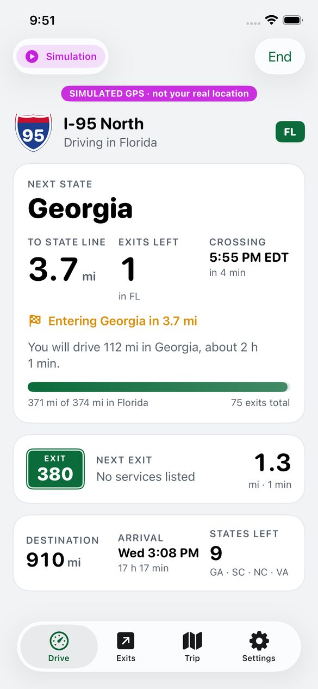
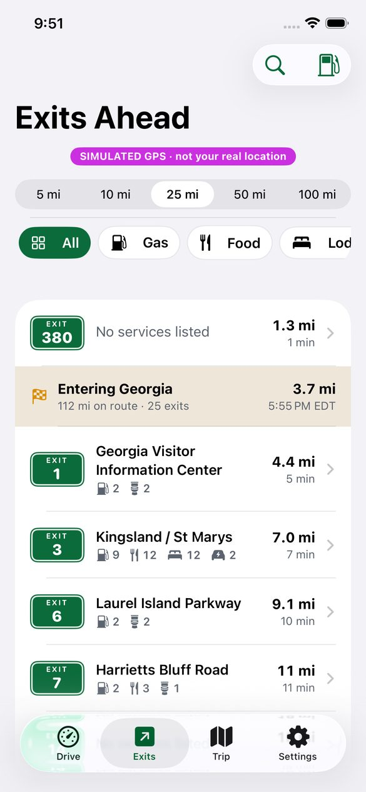
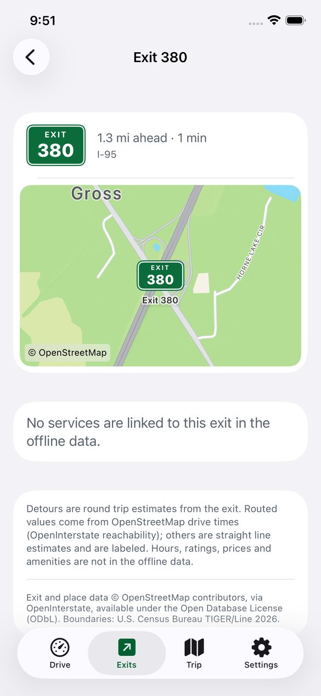
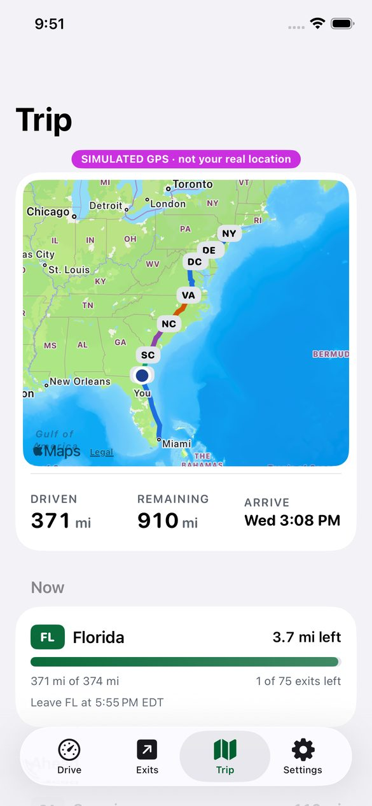
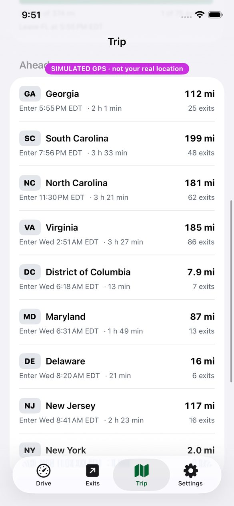
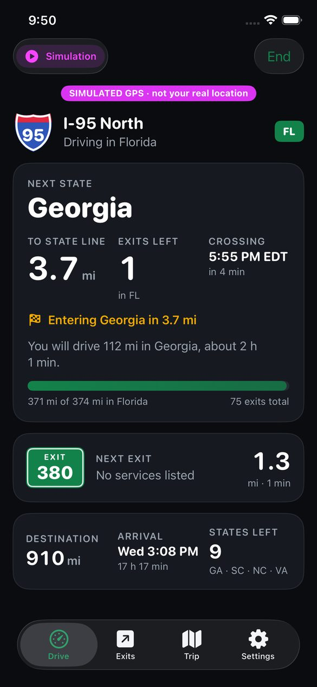
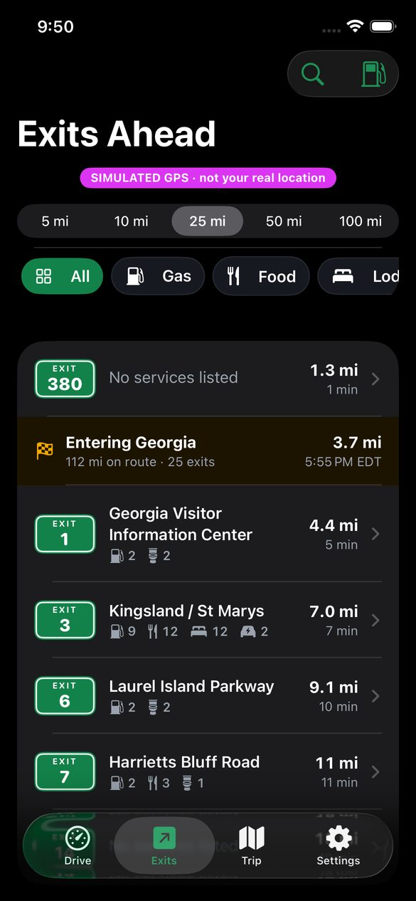
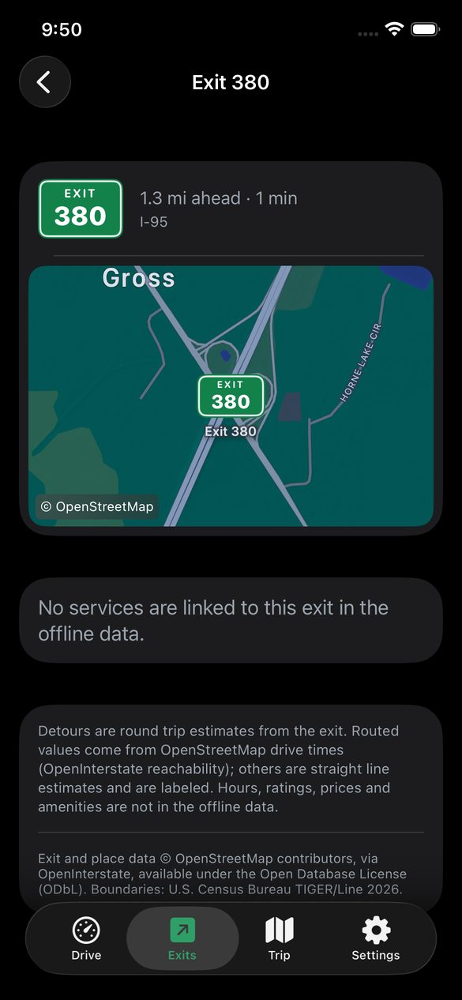
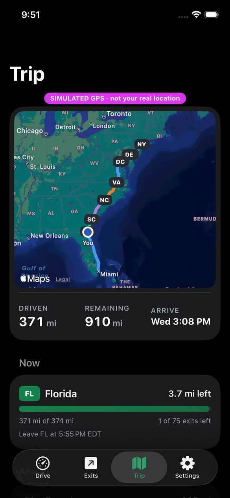
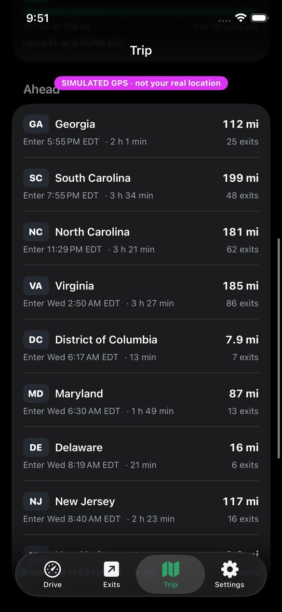

# 6. Screens

Design language: interstate guide sign green, shield blue and red, amber for border and caution states, on a calm dashboard background. Large rounded numerals with monospaced digits so values do not jitter while driving. Light and dark modes are both first class. The Drive screen shows tracking status (on route, estimating without GPS, off route, signal lost, simulation); Drive, Exits and Trip show the simulation banner.

Screenshots of the real app are generated by CI (latest macOS runner and Xcode, the last available iPhone simulator; an iPhone 16e with Xcode 26.6 when last checked) from the bundled demo trip, frozen near the Florida and Georgia line (`App/ExitAtlasUITests`). They show simulated GPS on a sample route, not a real drive.

| Drive | Exits | Exit detail | Trip | Itinerary |
|---|---|---|---|---|
|  |  |  |  |  |
|  |  |  |  |  |

## 6.1 Drive (active driving)

Order of importance, top to bottom:
1. Header: highway shield and signed direction ("I-95 North"), current state badge, tracking status pill.
2. State line card (the signature card):
   * Next state name, large.
   * Three numbers: miles to the state line, exits left in this state, crossing time in the local time of the border with time until it.
   * Amber "Entering Georgia in 3.4 mi" line under 5 miles.
   * "You will drive 112 mi in Georgia, about 1 h 41 min."
   * Progress bar: "355 of 374 mi in Florida · 61 exits total".
   * In the final state: miles left in that state instead.
3. Next exit card: green exit tab, name or destination, service icons with counts, miles and minutes.
4. Destination row: miles to destination, arrival time, states left with the next few codes.

Idle state: two cards, Plan a route and Start discovery mode, plus a Resume card when a saved trip can be continued. Discovery mode shows "Waiting for highway speed" or "Looking for an interstate" until it locks on.

## 6.2 Exits

* Window control: 5, 10, 25, 50, 100 miles.
* Category chips: All, Gas, Food, Lodging, Rest Area, EV Charging, Dog Park. A chip hides exits without that service.
* Rows in route order: exit tab, name, service counts, distance and time. Exits without bearing data show "Direction not verified in source data".
* State line rows are inserted where the route crosses: "Entering Georgia · 112 mi on route · 34 exits", distance and local entry time, amber background.
* Toolbar: Find along route (multi criteria), Gas ahead (range and detour).
* Exit detail: map of the exit and its places (OSM credit on the map), services grouped by category with detour ("Detour 1.3 mi round trip · about 4 min" when routed, "Roughly ... (straight line estimate)" otherwise), directions hand off to Apple Maps per place.

## 6.3 Trip overview

* Map with the route drawn per state in alternating colors, state badges at each crossing, current position.
* Summary: driven, remaining, arrival.
* Completed: states actually driven, from the trip ledger, with miles.
* Now: current state with progress bar, miles left, exits left of total, time leaving the state.
* Ahead: every upcoming state with miles, local entry time, duration, exit count; reentries marked "(again)"; brief crossings flagged.
* Actions: Plan a stop ahead, Share itinerary (text), End trip.

## 6.4 Planner (Trip tab when no trip is active)

* From (current location by default), stops (add, swipe to delete, drag to reorder), To.
* Avoid tolls.
* Find routes: every alternative MapKit returns, each with time, distance, tolls badge, a strip of state badges with miles per state, and counts of states, state lines and exits. Start or Simulate.
* Simulated demo: Miami to Manhattan.
* Saved trips.

## 6.5 Sheets

* Find along route: categories that must all be at the same exit, brand or name, window by distance or by drive time.
* Plan a stop: Hotel, Food, Gas, Rest area, EV charging after about N hours (±30 minutes), optional brand.
* Gas ahead: fuel level slider, usable range from MPG, tank and a 2 gallon reserve, reachable stations with detour, stations beyond range dimmed, and a clear "No verified fuel prices" notice.

## 6.6 Settings

Voice (state lines, exits), vehicle (MPG, tank, fuel grade, preferred brands), avoid tolls, lifetime miles and states, trip history, data sources and licenses with dataset build dates.

## 6.7 CarPlay plan (Phase 4, not built)

Facts from Apple's CarPlay Developer Guide, October 2026 edition ([guide](https://developer.apple.com/download/files/CarPlay-Developer-Guide.pdf)):
* Categories that could fit: Driving Task (`com.apple.developer.carplay-driving-task`) or Fueling (`com.apple.developer.carplay-fueling`). Categories cannot be combined except fueling with EV charging.
* Driving Task templates: action sheet, alert, grid, list, tab bar, information, point of interest. No map template. Depth 2 templates (3 from iOS 26.4). Do not refresh data more than once every 10 seconds, or points of interest more than once every 60 seconds. "Tasks must actually help with the drive." Not for store finders.
* Lists may be limited to 12 items by the car. Notifications are supported for driving task apps from iOS 18.4.
* The entitlement is requested from Apple and approval is not guaranteed. iExit was approved as a fueling app (its version notes, April 2025).

Proposed CarPlay design (Driving Task, framed as road status ahead):
* Tab 1 "Ahead": information template. Next state, miles and exits to the line, crossing time; next exit; destination ETA.
* Tab 2 "Exits": list of the next 12 exits with distance and service counts; tapping shows an information template with the top services.
* Tab 3 "Stops": rest areas and planned stops ahead.
* State line notification at 5 miles (iOS 18.4+).

Fallback with no entitlement, available on iOS 26: a Live Activity in the small family shows in the CarPlay Dashboard ("Exit 98 · 2.1 mi | GA line 41 mi"), plus a small widget. Apple: "Your app does not need to be a CarPlay app." Live Activities last up to 8 hours and must be restarted for longer drives.

## 6.8 Driver distraction rules applied

* No text entry needed while driving; search sheets are for planning.
* Numbers are the largest elements; labels are secondary.
* One message spoken at a time; music ducked only while speaking.
* No animation on numbers that change every second.
